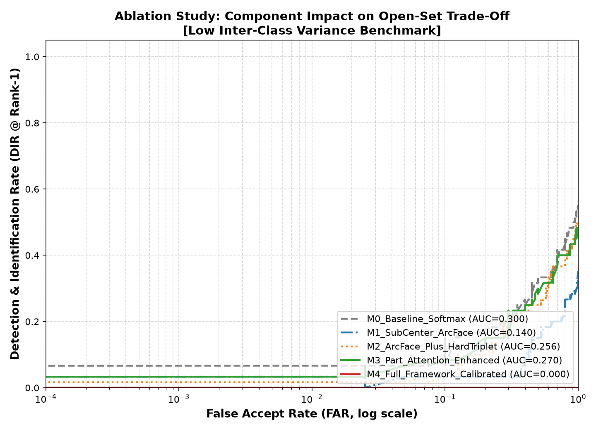

# Ablation Study Analysis: PS-1 Open-Set Person Re-ID

Evaluation on Low Inter-Class Variance Benchmark (Same Uniform Attire)

| Model Variant                |   Rank-1 (%) |   mAP (%) |   DIR@FAR=0.1% (%) |   DIR@FAR=1% (%) |   DIR@FAR=5% (%) |   FAR@TAR=90% (%) |    AUC |
|------------------------------|--------------|-----------|--------------------|------------------|------------------|-------------------|--------|
| M0_Baseline_Softmax          |         55   |      60.8 |                6.7 |              6.7 |              6.7 |              95   | 0.3    |
| M1_SubCenter_ArcFace         |         35   |      42.7 |                3.3 |              3.3 |              3.3 |              95   | 0.1396 |
| M2_ArcFace_Plus_HardTriplet  |         50   |      56   |                1.7 |              1.7 |              1.7 |              95   | 0.2562 |
| M3_Part_Attention_Enhanced   |         48.3 |      56   |                3.3 |              3.3 |              6.7 |              95   | 0.2704 |
| M4_Full_Framework_Calibrated |         40   |      47.2 |                0   |              0   |              0   |              97.5 | 0      |

