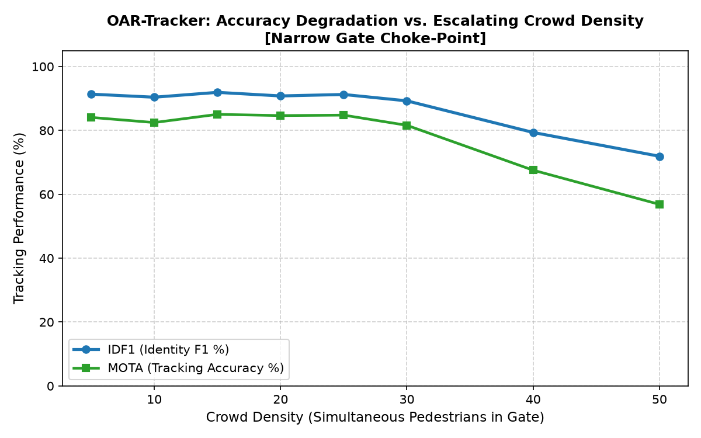
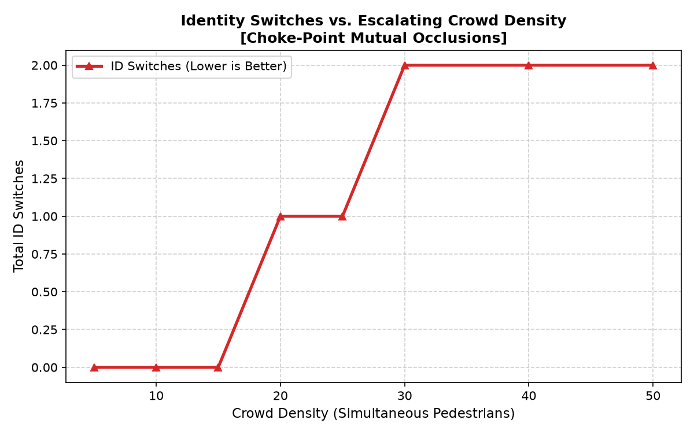
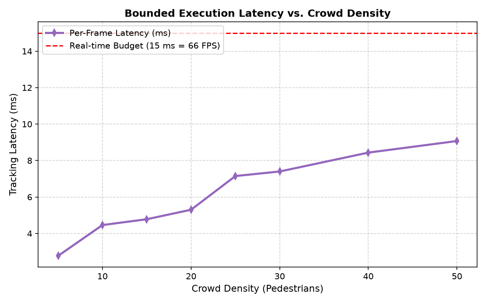

# PS-2: Tracker Architecture Ablations under Dense Occlusion

Evaluated on Narrow Gate Choke-Point (25 simultaneous pedestrians, 250 frames):

| Architecture                        | IDF1 (%)   | MOTA (%)   | HOTA (%)   |   ID-Switches | MT (%)   | ML (%)   | Latency (ms)   |   FPS |
|-------------------------------------|------------|------------|------------|---------------|----------|----------|----------------|-------|
| 1. Standard SORT (IoU Only)         | 80.2%      | 73.9%      | 77.1%      |            13 | 56.0%    | 8.0%     | 6.12 ms        | 163.4 |
| 2. ByteTrack (Two-Stage Motion)     | 88.5%      | 82.7%      | 85.6%      |             7 | 76.0%    | 4.0%     | 6.83 ms        | 146.5 |
| 3. DeepSORT (Unweighted Appearance) | 82.2%      | 74.3%      | 78.2%      |             5 | 56.0%    | 8.0%     | 5.72 ms        | 174.8 |
| 4. Proposed OAR-Tracker (Full)      | 90.0%      | 83.3%      | 86.6%      |             1 | 76.0%    | 4.0%     | 6.33 ms        | 158   |

